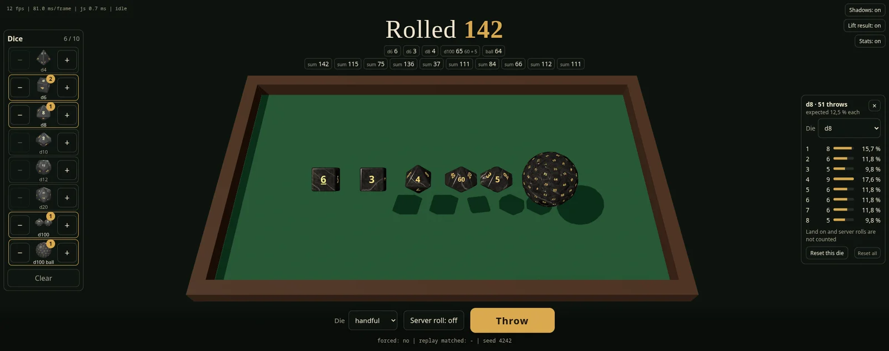

# vtt-dice

A set of 3D dice for virtual tabletops, plus a browser demo that throws them.
The dice are black marble with engraved gold numbers: d4, d6, d8, d10, d12,
d20, the percentile pair (d10 tens + d10) and a 100-face ball. You can use the
models in your own tabletop; the demo shows one way to throw them with physics
and how to make a throw end on a chosen number.

**Try it in your browser: [haxinpro.github.io/VTT-Dice](https://haxinpro.github.io/VTT-Dice/)**



## Run the demo

The demo is plain HTML and JavaScript with no build step and no network use at
runtime (the libraries are in `vendor/`). ES modules need http, so serve the
folder:

```
python3 -m http.server 8790 --bind 127.0.0.1
# open http://127.0.0.1:8790/
```

Because it is static, the folder also works on GitHub Pages; the live demo
linked above is served that way from this repository.

## Features

- **Dice picker and handful**: one die or up to 10 dice at once (the d100 pair
  counts as two), built from a dice panel with icons.
- **Real physics**: three.js draws, cannon-es simulates; fixed time step, rest
  detection and a safe fallback so a die always ends flat on a face.
- **Chosen results**: "Land on" (one die) and "Server roll" (a handful, a
  random result per die picked as a server or game master would) simulate the
  throw, then relabel the dice by a symmetry so the throw ends on the chosen
  number, and replay it. See `docs/faces-json.md`.
- **Hand box**: press the table, shake and release; the dice rattle in a box
  and are flicked out when you let go.
- **Lifted result**: the rolled faces float to the camera with the digits
  upright and a big total.
- **Tally**: counts how often each number came up, per die (free throws only).
- **d100**: as a pair (tens + ones, `00 + 0 = 100`) and as a 100-face ball.
- Works with mouse and touch, light on resources (blob-shadow option).

More detail about the demo is in `docs/demo.md`.

## Use the dice in your VTT

Everything you need is in `dice/`:

- **3D**: `dice/models/<die>.glb` + `<die>.faces.json`. The `.glb` has two
  materials (`body` and `numbers`); the `.faces.json` says which face is which,
  how to read a result and gives a physics hull. The full set has 2048 px
  textures; `dice/models/high/` (1024 px) and `dice/models/light/` (512 px) are
  the same models with lighter textures for phones and weaker GPUs; your VTT
  picks the set (the demo always loads the full set).
- **2D**: `dice/results/<die>/<value>.webp`, 512 x 512 pictures with
  transparent background of every die showing every value.
- **Icons**: `dice/icons/<kind>.webp` for a picker.

The integration guide is **[docs/faces-json.md](docs/faces-json.md)**: file
format, reading a result, and forcing a result. You do the integration in your
own engine; the demo code (`main.js`, `physics.js`) is a working example.

## Regenerating the models

`tools/dice3d.py` builds the models and pictures in Blender 5.2, see
[tools/README.md](tools/README.md).

## Project layout

```
index.html, main.js, physics.js   the demo
vendor/                           three.js and cannon-es (MIT)
dice/models, icons, results       the dice set
docs/                             integration guide, demo notes
tools/                            Blender generator script, WebP metadata stamper
```

## Licences

| What | Licence |
| --- | --- |
| Code (`index.html`, `main.js`, `physics.js`, docs) | MIT, see `LICENSE` |
| Dice assets (everything in `dice/`) | CC BY 4.0, see `LICENSE-ASSETS.md` (credit: Haxinpro) |
| `tools/dice3d.py` | GPL-3.0-or-later, see `tools/LICENSE` (it runs inside Blender's Python API) |
| `vendor/` | MIT (three.js, cannon-es), see `THIRD_PARTY_NOTICES.md` |

The digits use the letter shapes of Noto Sans Bold (SIL Open Font License 1.1).

## Credits

Dice, code and pictures by Haxinpro. Built with [three.js](https://threejs.org),
[cannon-es](https://github.com/pmndrs/cannon-es) and
[Blender](https://www.blender.org). Full list: `THIRD_PARTY_NOTICES.md`.

This project is not affiliated with or endorsed by any tabletop game publisher.
